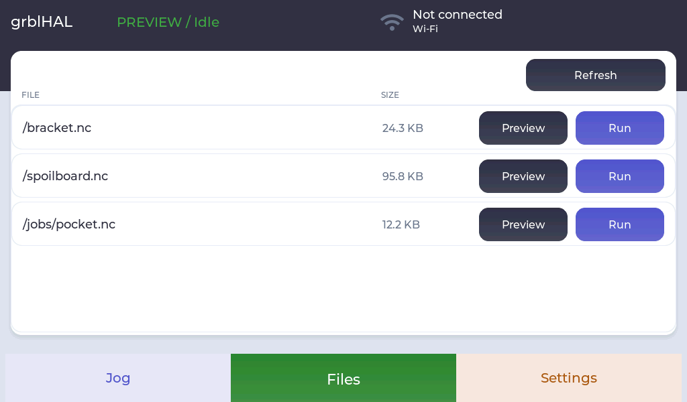
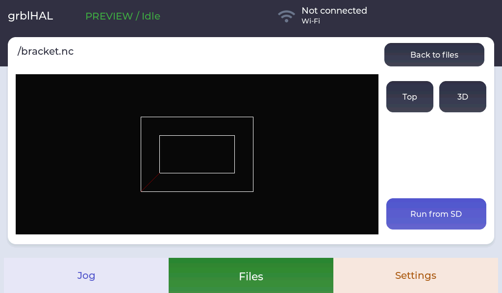
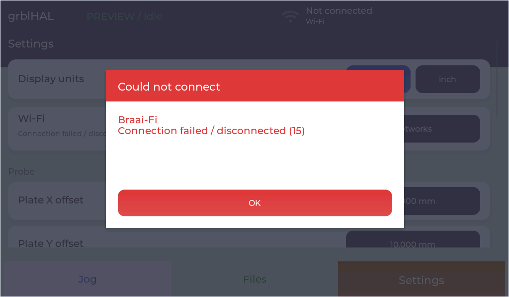

# grblHAL panel

A touchscreen pendant for grblHAL CNC controllers, built for the VIEWESMART
7-inch ESP32-P4/C6 display. Home the machine, set up the stock, choose a file
from the controller’s SD card and follow the job from a dedicated run screen.

The landscape layout puts the position readout on the left and the jog controls
on the right for two-handed use. Large controls, axis colours and clear alarm
screens keep the common machine operations within reach.

## Machine setup

- **Jog:** eight-direction XY pad, separate Z controls, incremental moves or
  continuous movement while held. Releasing a continuous jog stops it.
- **Jog speed:** Slow, Med and Fast presets, with metric steps of
  0.1 / 1 / 10 / 100 mm or imperial steps of 0.01 / 0.1 / 1 / 10 inch.
- **Position:** compact machine and work coordinates, individual axis homing
  and zeroing, Home All, Set Zero All, Go to XY Zero and Go to Z Zero.
- **Work offsets:** G54–G59 selection beside the Probe control.
- **Corner probing:** XYZ touch-plate setup with tool diameter entered on a
  numeric keypad. Plate dimensions and probe settings are configurable.

Go-to-zero and zero-setting actions require confirmation. Go to XY Zero moves
via machine Z −5 mm before moving X and Y, then restores the previous machine Z.
Go to Z Zero moves directly to work Z0. Check this clearance against your setup.

## Files and jobs

Browse files on the **controller’s SD card**, with file sizes and Preview/Run
actions in each row. Preview downloads the selected file into display memory
and shows its toolpath in Top or 3D view. Drag to pan and pinch to zoom.
Running a file is a separate, confirmed action.

During a job, the run screen shows positions, progress and elapsed time, with
Pause/Resume and Stop below the readout. Feed and spindle overrides use the
controller’s reported values. Setup navigation is hidden until the job ends.
After Job Complete is acknowledged, the pendant returns to Jog.

Alarms and command errors appear in red dialogs. The header fault indicator
reopens the current fault. Job Stop sends a controller reset; check position
and re-home as needed afterward. Emergency stopping remains a hardware function.

The toolpath viewer supports G0/G1 and IJK G2/G3 arcs in G17/G18/G19, absolute
and relative coordinates, and metric/imperial files. The download limit is
2 MiB. Macros, canned cycles, R arcs and offset-changing codes are unsupported
for preview; those files can still be run directly from controller SD.
The preview does not simulate collisions or controller execution.

## Settings and Wi-Fi

Choose metric or imperial display units, configure the controller UART, and
adjust probe geometry and feeds. Display units are converted locally; generated
motion commands and internal geometry remain in millimetres.

Open Wi-Fi from Settings or the header icon. Scan, select a network and enter
its password using the onscreen keyboard. Each network row shows signal strength
and a lock for secured networks. The connection result appears in a popup;
OK closes both the popup and network window. Successful credentials are saved
for reconnection. The header shows the connected SSID and IP address.

## Hardware and project status

- VIEWESMART 7-inch 1024×600 ESP32-P4 display with ESP32-C6 Wi-Fi coprocessor.
- Native LVGL interface, built with ESP-IDF 5.3.4 and LVGL 9.2.2.
- Controller UART defaults: TX GPIO37, RX GPIO38, 115200 baud; configurable in Settings.
- USB UART for programming and development tools.

This is firmware under development. The interface and Wi-Fi have been exercised
on the display. Physical controller motion, probing and SD transfers still need
hardware validation. RS485 and the grblHAL panel plugin are being investigated.
The source also includes an experimental Wi-Fi G-code handoff and controller-SD
upload implementation; end-to-end transfer validation and its user interface
are pending.

## Build and development

With ESP-IDF 5.3.4 installed and its environment activated:

```powershell
cd firmware/viewesmart-p4
$env:IDF_TARGET='esp32p4'
idf.py build
idf.py -p COM12 app-flash
```

Replace COM12 with your display’s port. The checked-in `sdkconfig` contains the
tested board configuration. ESP-IDF downloads the managed components listed in
the dependency manifests and lock file.

Development tools capture the actual LCD framebuffer and inject taps, holds and
swipes over USB UART. Demonstration mode disconnects the controller UART and
supplies sample machine feedback for UI checks.

- [Development instructions and source map](AGENTS.md)
- [Screenshot, touch injection and test guide](docs/device-ui-development.md)
- [UART, RS485 and panel-plugin investigation](docs/hardware-and-protocol.md)

## Screenshots

Screens from the 1024×600 display. Machine data and SD files shown here are
sample data from demonstration mode; Wi-Fi uses the onboard radio.

**Jog — metric, incremental**


<details>
<summary>Jog modes, probing and confirmations</summary>

**Continuous jog**


**Disabled controls during Hold**


**Inch display**


**Corner probing**


**Numeric input**


**Homing confirmation**


**Zeroing confirmation**


</details>

<details>
<summary>Settings</summary>

**Display units and Wi-Fi**


**Probe configuration**


**Probe feed and corner start inset**


**Controller UART configuration**


**Inch display setting**


</details>

<details>
<summary>Controller files and toolpath preview</summary>

**Controller SD listing — sample files**



**3D view**


**Top view**



**Run confirmation**


</details>

<details>
<summary>Running, paused and completed jobs</summary>

**Running**


**Paused**


**Complete**


</details>

<details>
<summary>Alarms and command errors</summary>

**Controller alarm**


**Command error**


</details>

<details>
<summary>Wi-Fi scan, password entry and connection results</summary>

**Scan in progress**


**Scanned networks**


**Password entry**


**Password validation**


**Connection failed**



**Connected**


</details>

Board source and documentation:
[VIEWESMART hardware](https://github.com/VIEWESMART/7-1024X600-ESP32-P4-C6-TOUCH-DISPLAY).
Existing component licenses are retained in their source directories.
