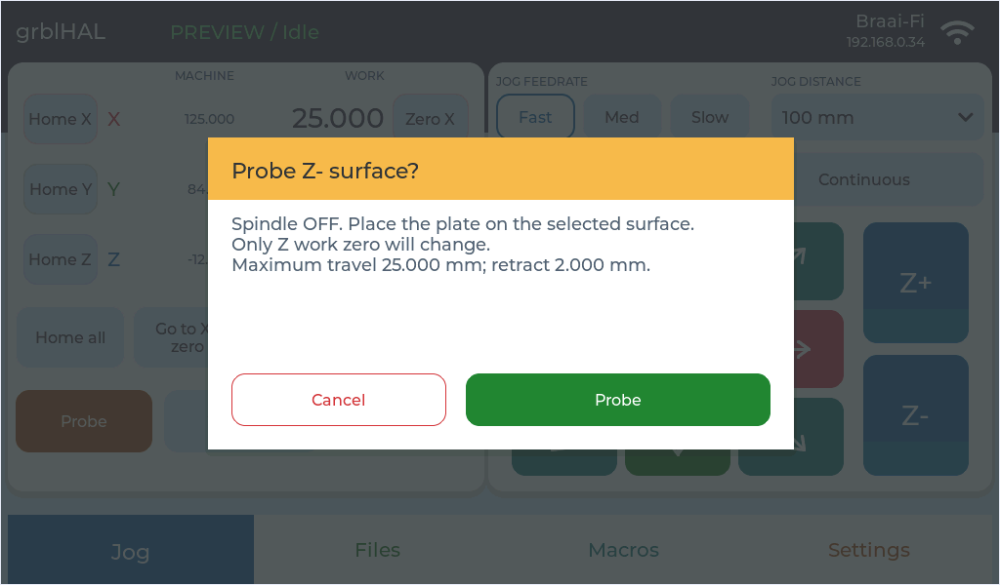
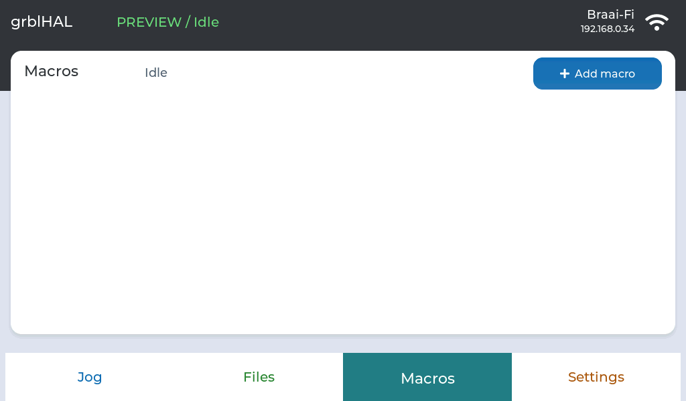
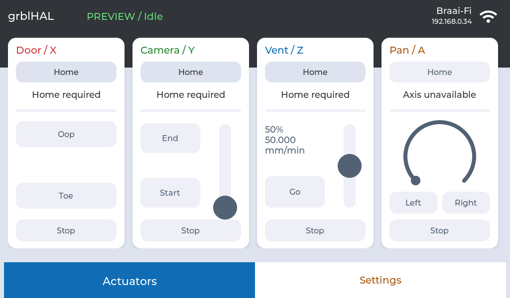

# Interface colours

The pendant uses light neutral cards and a charcoal header. Colour highlights
controls and state rather than filling every surface.

| Role | Colour | Use |
| --- | --- | --- |
| Primary | Blue `#176FB5` | Normal dialog headers, selections, settings, sliders and progress. |
| Positive | Green `#238636` | OK, Apply, Save, Connect, Run, Probe and Resume. |
| Destructive | Red `#D3343B` | Stop/Delete actions and alarm/error headers. |
| Cancel | Red outline/text on white | Cancel without competing with the main action. |
| Warning | Amber `#F2B94F` with charcoal text | Existing movement/spindle/probe confirmation headers and Pause. |
| Warning text | Dark amber `#8A5500` | Probe instructions on light backgrounds. |
| Secondary text | Slate `#566273` | Labels and supporting information. |
| Disabled | Pale grey with dark slate text | Unavailable controls remain readable. |

Green and red actions use solid fills. Blue buttons keep a subtle gradient.
Tabs use solid active colours and white inactive backgrounds. Axis colours
identify X/Y/Z; tab and macro colours identify sections/categories, with labels
so they are not mistaken for machine state.

Warning headers use dark text, not white. Resume changes its label colour
along with its green background. Slider tracks remain visible to both sides
of the thumb. Settings group selection uses a blue border/text on white.
The actuator web dashboard shares the primary and text colours.

## Contrast checks

`python tools/check-colors.py` checks the named palette pairs, the light end of
the blue button gradient, and the absence of retired purple accents. Nominal
text contrast is 5.28:1 for white on blue, 4.63:1 for white on green, 4.86:1
for white on red, and 6.89:1 for charcoal on amber. Secondary text is 4.73:1
or better on the intended light surfaces.

These checks do not claim full accessibility compliance. Framebuffer captures
cannot verify the physical LCD's viewing angles or perceived brightness.

## Hardware indicators

The onboard WS2812B LED is D4, connected to GPIO30 through R60 in the VIEWE
schematic. It shows green for connected Idle/completion, amber for movement,
probing, Run or Hold, red for alarms/errors, and dim white when disconnected.
Read-only settings queries do not change Idle green into movement amber.
The LCD also supplies state text; the LED is supplementary.

Settings > Screen brightness adjusts the backlight immediately from 10 to 100%.
The value is saved on release in `panel/backlight` and restored at startup.
The existing Preferences blob is unchanged. The minimum prevents accidentally
blanking the screen. `tools/check-hardware-ui.py --no-captures` checks the slider,
reboot persistence and RGB driver's transmitted status colours in UART-off demo.
Physical LED appearance still needs a person at the board to confirm it.

## Audit coverage

The audit covers shared buttons/dialogs and their overrides in Jog, Files,
Settings, Machine settings, Probe, job controls, faults/completion, Wi-Fi,
Macros and Actuators, plus the actuator browser page. The source inventory and
contrast checks are complemented by current hardware captures using
`tools/capture-color-audit.py`. Accepted captures are inspected before being
copied into the product gallery; wrong-page or interrupted captures are rejected.

Completion deliberately uses a white OK button on its green card. Empty macro
positions stay white rather than appearing as disabled pastel controls. Disabled
actuator sliders and angular controls use slate thumbs rather than active blue.
The full slider track is slate `#7F8FA3`, with at least 3:1 contrast against white.

## Captured examples

These are framebuffer captures from the pendant, with simulated controller feedback.

| Normal controls | State and confirmation |
| --- | --- |
|  |  |
|  |  |
|  |  |
|  |  |
|  |  |
