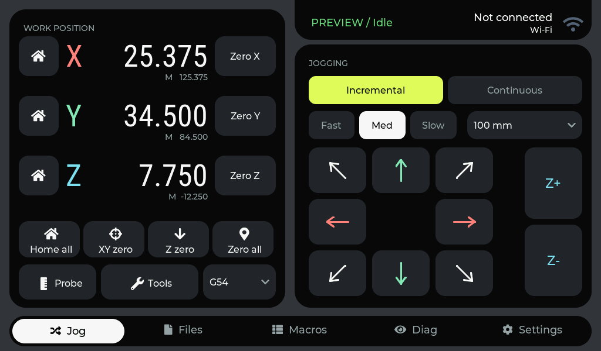

# Jog card concept

An experimental Jog screen and floating navigation dock for the 1024 × 600 LCD.
The existing control handlers and dialogs remain in place. Files now shares this
style; see [Files design](files-design-qa.md) and [Macros design](macros-design-qa.md).

## Reference and implementation

| Reference direction | LCD treatment |
| --- | --- |
| Black cards on graphite | Native LVGL rounded rectangle cards; custom shoulder drawing removed |
| Large clean numeric typography | Roboto Condensed 52 px for work coordinates and aligned XYZ labels; machine positions sit directly below their work values |
| Selective vivid accents | Lime selected mode, coral X, mint Y, cyan Z; neutral action pads including Probe |
| Floating pill navigation | Black dock, white active pill, icons and 18 px labels |
| Uncluttered widgets | Existing homing, zeroing, WCS and motion controls retained in two groups |

The phone-sized references guide shape, contrast and typography. Controls remain
large enough for two-handed landscape use rather than copying the reference layouts.
The font's SIL Open Font License is distributed with the firmware assets.

The left card uses the former brand-header space for 68 px-high per-axis Home/Zero
targets, 62 px global actions and 60 px Probe/Tools controls. Status and Wi-Fi share
a black rounded rectangle header card aligned with the Jogging card. Its upper
corners extend off-screen so the visible card joins the top bezel, with rounded
lower corners and the same text positions. The redundant units label is removed. Home all, XY zero, Z zero,
Zero all, Probe and Tools have matching Font Awesome action icons; labels and
touch targets are retained.

The disabled distance selector dims its background, text and arrow together.

## Device checks

- ESP-IDF application build and verified app-only flash on COM12.
- Framebuffer screenshot checked for clipping, alignment and contrast.
- Files and Settings navigation checked; Settings retains its existing light layout.
- Native mode selector checked in both Incremental and Continuous.
- Disabled distance selector ignores taps in Continuous mode.
- Diagonal incremental jogging emits `$J=G91 G21 X-100.000 Y100.000 F3000.0`.
- Continuous jog release emits `0x85`.
- Probe opens and closes through the existing modal.
- All motion checks use UART-disconnected demo mode. Physical touch restored afterward.
- Approved temporary macros Setup 01–18 removed; remaining macro count is zero.

## Reverting

The original source and application binary are in the ignored folder
`captures/backups/jog-original-ae3fbad/`, including `RESTORE.txt`.
The original tracked implementation is commit `ae3fbad` on `main`.
This experiment is isolated on the local `jog-card-concept` branch.
The existing README gallery remains unchanged pending design review.

The treatment is in `panel_jog_concept.inc`; geometry and temporary visual states
are restored when leaving Jog because the DRO widgets are shared with Job.

The custom card-shape draw callbacks have been removed. Tab slides retain the
existing 220 ms animation and use native rounded rectangle rendering. An
intermittent framebuffer-capture reset recurred during verification; it remains
unresolved and is separate from a successful navigation check.
