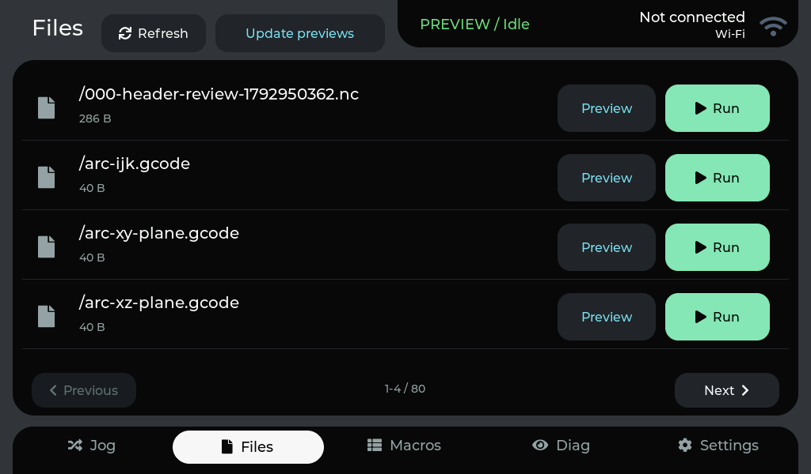
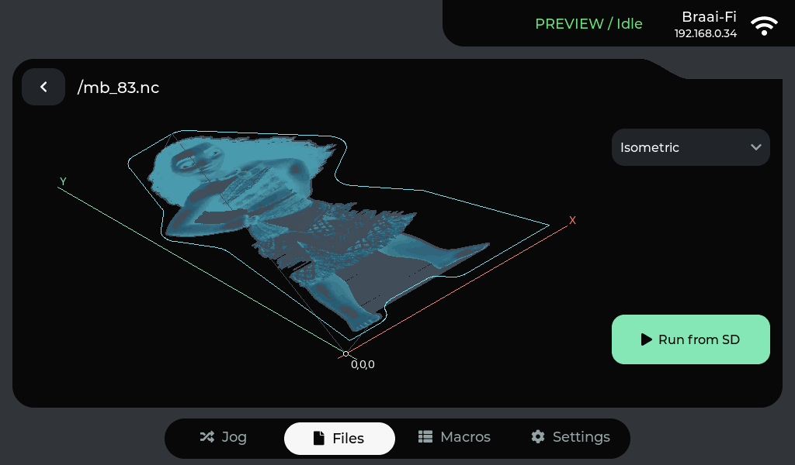
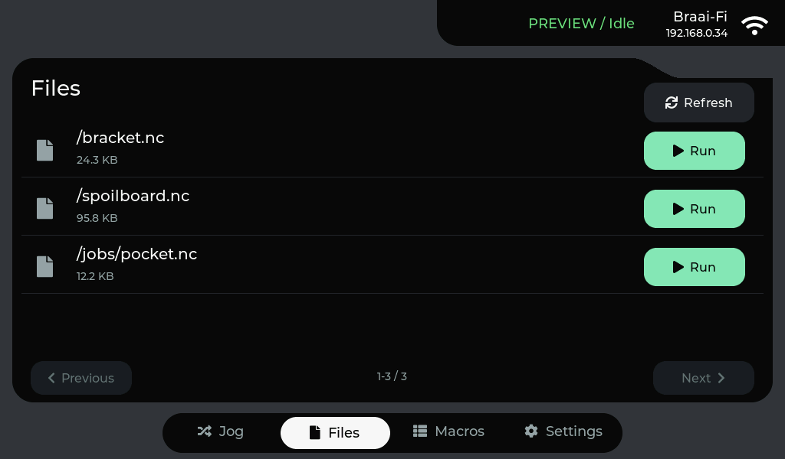
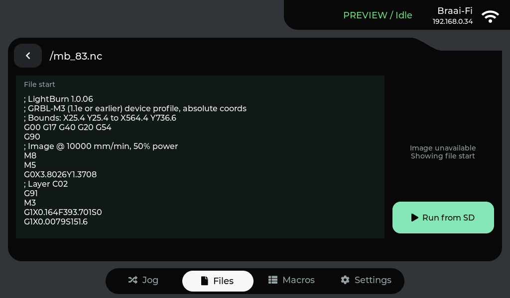
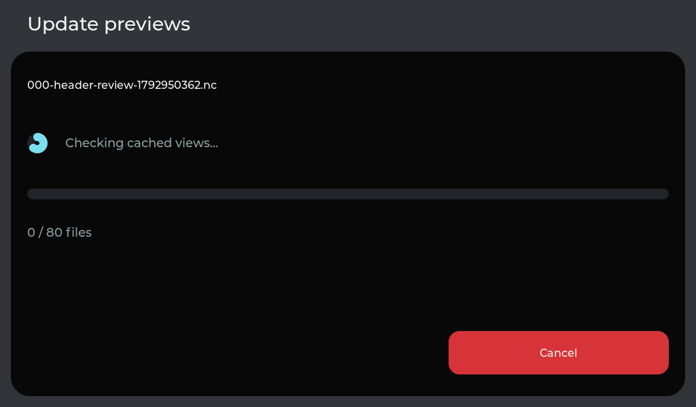

# Files card design

The Files library and preview share the Jog screen's graphite background, black
rounded rectangle card, bottom dock and status/Wi-Fi card.

| Library | Rendered preview |
| --- | --- |
|  |  |

File names and sizes are grouped together. Cyan Preview actions and mint Run
actions remain in each row; pagination has separate large touch targets. The
controller-SD list keeps Run only. The existing confirmation is still required.
Update previews is an explicit action beside Refresh. Its progress window shows
the filename, stage, percentage and files checked, with Cancel. Browsing does not
start preparation or downloads.

The preview retains a top-left back arrow and a view selector. If an image is
missing or still being prepared, the file's opening G-code remains readable.

## Renderer

Renderer 4 matches the card background, with cyan toolpaths, muted rapid moves,
coral X and mint Y origin axes, and a light origin marker. PNG and native RGB565
views use the same pixels. Versioned HTTP and SD caches keep older white images
separate; the previous caches and G-code files are retained.

Small path indexes restore cached previews after reboot without re-reading the
G-code. Explicit updates verify file contents and prepare missing views.

## Checks

- Application build and verified app-only flash on COM12.
- Both display-SD and simulated controller-SD lists captured on the real LCD.
- Pagination, preview back navigation and Jog/Files round trip checked.
- Run confirmation checked without starting a job.
- All eight views and image pan checked by `tools/check-preview.py`.
- Manual update, cancellation and idle browsing checked through `UG SD STATE`.
- Eight renderer/HTTP tests pass, including PNG/RGB565 parity, origin colors,
  upload hash validation and rejection of the old endpoint namespace.
- The real `mb_83.nc` example generated 5,453,279 segments in eight dark views.
- Controller UART remains disconnected in demo mode for all motion/UI checks;
  physical touch is restored afterward.

The original Files UI and application binary are preserved in the ignored
`captures/backups/files-before-dark/` folder. The original pre-concept Jog backup
is retained separately. README gallery replacements remain pending design review.

## Manual update

Files and Macros use native rounded rectangle cards, with titles and actions above
them. There are no custom shoulder masks or per-column shape drawing callbacks.
