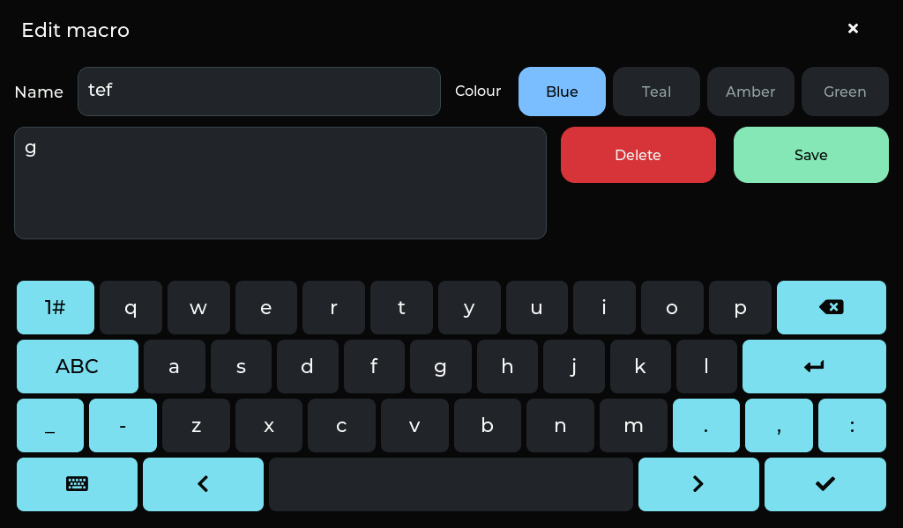

# Macros card

The library uses the same black rounded rectangle card and bottom dock as Files.
Square macro buttons have a wide colored left strip and a separate pencil action.
The macro name is shown without a play icon. Add remains above the card.

The saved macro library was preserved during the final read-only navigation check.

## Editor

Name and Colour share one row. Delete sits left of Save beside the G-code field; Add uses Cancel in the same left position.
Cancel/Delete use solid red and Save uses mint across the black editors.
The 1008 x 284 keyboard uses 22 px labels and fills the lower half of the display.
Typing, textarea focus, validation and closing without saving are checked on the
real LCD, with the saved macro library preserved.
