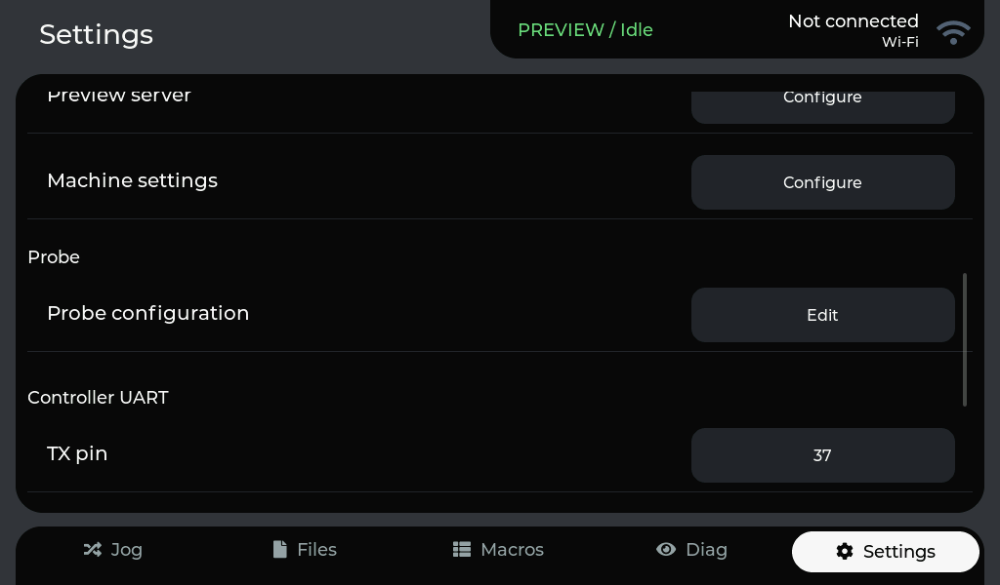
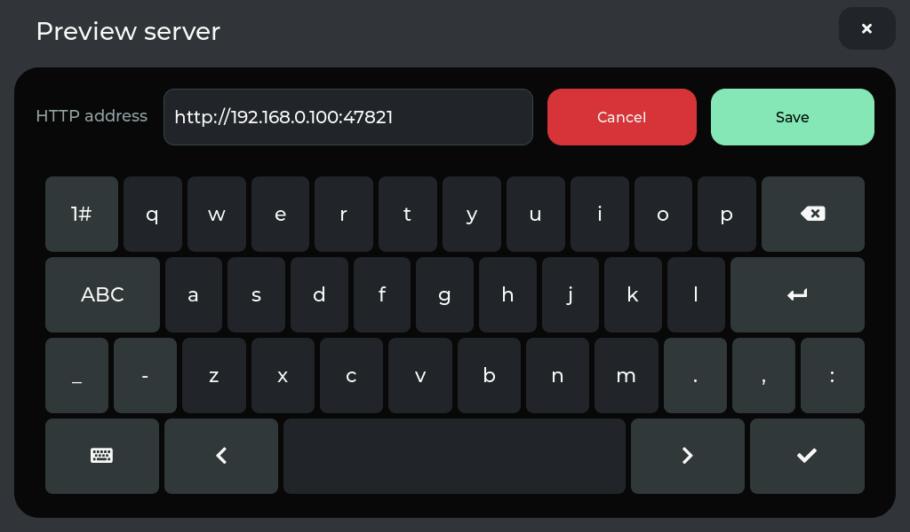
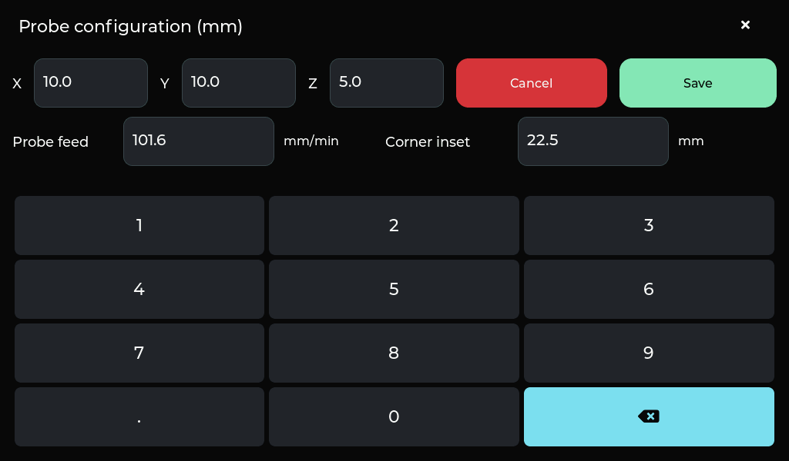
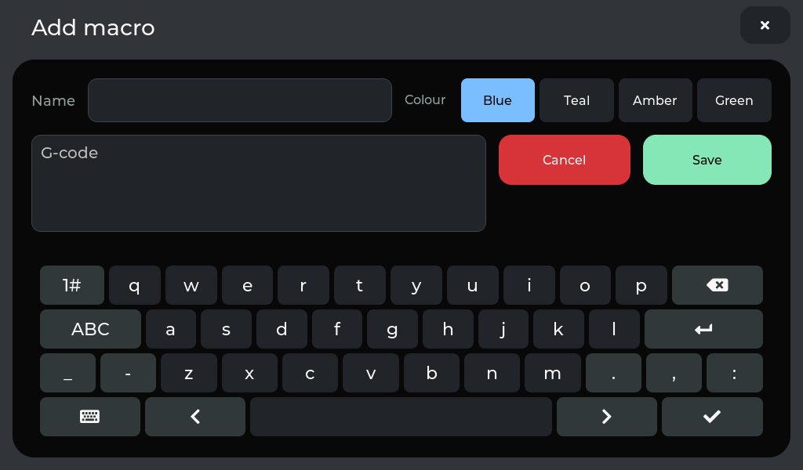
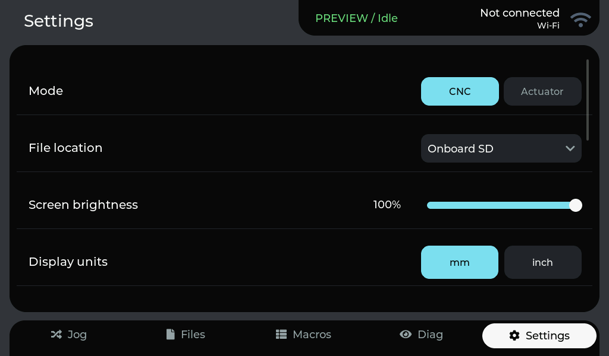

# Settings refinements

The Settings page uses the shared dark palette and flat list rows with dividers,
inside a rounded outer card, without individual row shadows. The heading sits
above the card and stays visible while the list scrolls. Preview server, Input
diagnostics and Machine settings use the same scrollable label/action rows as
the other preferences. Probe configuration has one Edit row for XYZ offsets, feed and corner inset.

| Settings actions | Preview server |
| --- | --- |
|  |  |

Preview server places Address, Save and Cancel on one row above the large
keyboard. Cancel discards unsaved typing.

## Probe configuration

X, Y, Z, probe feed and corner inset share a full-screen editor and one numeric keypad. Fields match the
Save/Cancel button height, use normal text, and show one decimal in mm or three
in inches. The keypad has digits, decimal and Backspace; there are no duplicate
Done/Cancel keys. All five fields are validated before any saved probe settings change.
Opening or cancelling never rounds a stored value. The probe dialog opens the
same editor and returns to probing afterward.

Editors use an opaque full-screen background without dimming or floating shadows,
blocking background controls. Closing restores the underlying page.

`tools/check-settings-rows.py` checks the settings actions, server Cancel, shared
keyboard focus and typing, all-or-nothing probe-configuration validation, Save/Cancel, unchanged
preferences and navigation in UART-disconnected demo mode.

## Black editor actions

Macro Add/Edit, Preview Server and Probe Configuration share the same action rules:
solid red Cancel/Delete on the left, mint Save on the right. Macro confirmations
use the same Cancel colour. The macro G-code input leaves room for its actions
side by side, with the keyboard below.

| Edit macro | Add macro |
| --- | --- |
|  |  |

## Settings and common header

The status/Wi-Fi container keeps the same position across the main pages, aligned
with both edges of the Jogging card. Its top extends beyond the screen edge,
joining the bezel while the lower corners stay rounded. Settings shares the graphite background,
black list, neutral dark buttons and cyan choice controls.

The drawing-buffer experiment is removed. Verification uses the original internal
DMA drawing buffer and the existing LCD framebuffer. Restoring an old-dated source
backup initially left a stale experimental object in the build; recompiling the
restored source removes that mismatch.
